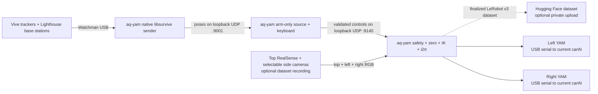

# UMI Teleop

Standalone native-Linux Vive teleoperation for two UMIs and two YAM robot arms.

> **Physical safety:** `umi-yam --confirm-clear` energizes both arms and holds their current joint
> positions. Automatic startup motion is opt-in through `--move-to-ready` or `--move-to-base`.
> Clear the complete workspace first. Stopping the process releases active holding, so support the
> arms before pressing Ctrl+C. Never connect or disconnect powered hardware.

## Architecture



The complete live path runs on `aq-yam`. `umi-vive-linux` reads the Watchman receivers directly
through libsurvive, with no Steam or SteamVR installation. `umi-source --arm-only` validates and
maps the two tracker serials, carries sensor age and explicit tracking loss forward, and reads
keyboard controls. `umi-yam --arm-only` owns zeroing, workspace limits, inverse kinematics, joint
limits, slew limits, CAN access, and motor commands. Its grippers hold their measured startup
positions; tracker motion never commands them. No UMI Pi, Windows machine, ArUco camera, GPIO, SSH,
or network switch is part of the teleoperation runtime path.

The two UDP hops use `127.0.0.1`. They retain the existing independently testable packet boundaries
without adding network latency. Optional policy-dataset cameras connect directly to `aq-yam` and
leave it only when explicit Hub upload is enabled.

One root `pyproject.toml` and lockfile keep the tracker, protocol, safety, and tested AfterQuery
`i2rt` revision together. Every Python CLI uses Tyro; run a command with `--help` to inspect or
override its typed defaults.

## Fixed Setup

| Role | Mapping |
|---|---|
| Teleoperation host | `aq-yam@aq-yam.local` |
| Native tracker input | Watchman USB receivers, local UDP `127.0.0.1:9001` |
| Local controller input | local UDP `127.0.0.1:9140` |
| Left leader | tracker `LHR-BBAF093A` |
| Right leader | tracker `LHR-C891E882` |
| Left follower | CAN adapter serial `209D378045465008` |
| Right follower | CAN adapter serial `206237A845465006` |

The native Lighthouse calibration is local machine data under `~/.config/umi-teleop`. The tested
AfterQuery `i2rt` commit containing the multi-turn gripper encoder-wrap fix is pinned in `uv.lock`.
No separate `robot-umi`, SteamVR, UMI Pi, or patched I2RT checkout is required.

## Install

Run the following on `aq-yam`:

```bash
sudo apt update
sudo apt install -y git curl build-essential cmake pkg-config can-utils \
  libusb-1.0-0-dev liblapacke-dev libopenblas-dev freeglut3-dev libx11-dev
sudo usermod -aG plugdev aq-yam
curl -LsSf https://astral.sh/uv/install.sh | sh
mkdir -p /home/aq-yam/Documents/Repos
git clone https://github.com/AfterQuery-Research/umi-teleop.git \
  /home/aq-yam/Documents/Repos/umi-teleop
cd /home/aq-yam/Documents/Repos/umi-teleop
uv sync --locked --extra yam --no-dev
./scripts/build-linux-vive.sh
sudo install -m 0644 config/udev/81-vive-watchman.rules \
  /etc/udev/rules.d/81-vive-watchman.rules
sudo udevadm control --reload-rules
sudo udevadm trigger
```

Log out and back in once after the `plugdev` group change, then replug the three Watchman receivers.
The udev rule grants device access only; it does not start a service or process. This repository
does not require systemd.

To record MolmoAct2-compatible LeRobot datasets on the same computer, install the optional Python
3.12 recording stack:

```bash
uv sync --locked --extra yam --extra dataset --no-dev
```

This adds LeRobot's dataset writer and RealSense support. It is not needed for arm-only
teleoperation.

### Calibrate native tracking once

Plug in and power both base stations. Press the center button on every Vive tracker and wait for a
green status light. Put all trackers on a stationary surface visible to both base stations, then
run:

```bash
cd /home/aq-yam/Documents/Repos/umi-teleop
.venv/bin/umi-vive-linux --calibrate
```

Leave the trackers still until libsurvive has decoded both base stations, solved the global scene,
and reports valid poses for all trackers. Press Ctrl+C. Later tracking runs reuse the calibration
under `~/.config/umi-teleop`; repeat calibration only after moving a base station.

#### Discover and configure CAN

Stop robot-control processes, then list the adapters without opening CAN or sending frames:

```bash
cd /home/aq-yam/Documents/Repos/umi-teleop
.venv/bin/umi-setup-can
```

The USB serial identifies an adapter even if Linux changes its `canN` name. Determine which cable
goes to each arm and label it. Never connect or disconnect powered CAN hardware. If an adapter must
be connected by itself to establish the mapping, first shut down `aq-yam` and remove YAM power.

Set the installation's left and right serials in the YAM shell. Replace the two example names with
the serials reported above:

```bash
export LEFT_CAN=209D378045465008
export RIGHT_CAN=206237A845465006
```

Configure both adapters after every reboot or replug:

```bash
.venv/bin/umi-setup-can \
  --left-adapter-serial "$LEFT_CAN" \
  --right-adapter-serial "$RIGHT_CAN"

ip -details -statistics link show type can
```

This performs only `ip link` setup and verification. It does not import i2rt, open a CAN bus, send
motor frames, or move the robot. Both links must report `UP`, Classic CAN at `1000000` bit/s, and
`ERROR-ACTIVE`. You do not need to repeat setup before each run unless `aq-yam` rebooted or an
adapter was replugged.

## Bring Up

1. Power the YAMs and base stations. Wake the left and right trackers and wait for green lights.
2. In terminal 1 on `aq-yam`, start native tracking:

   ```bash
   cd /home/aq-yam/Documents/Repos/umi-teleop
   .venv/bin/umi-vive-linux
   ```

   To inspect the stream before continuing, run the following in another terminal while
   `umi-source` is stopped:

   ```bash
   ./scripts/check-linux-vive-stream.py \
     --expect-serial LHR-BBAF093A \
     --expect-serial LHR-C891E882
   ```

3. In terminal 2, start the arm-only source and keep this terminal focused for controls:

   ```bash
   cd /home/aq-yam/Documents/Repos/umi-teleop
   .venv/bin/umi-source --arm-only --buttons keyboard --send-hz 60
   ```

   Continue only when it reports `enabled=False`, fresh left/right pose ages, and `bad_vive=0`.

4. Clear the full workspace around both arms. In terminal 3, start the local YAM controller:

   ```bash
   cd /home/aq-yam/Documents/Repos/umi-teleop
   export LEFT_CAN=209D378045465008
   export RIGHT_CAN=206237A845465006
   .venv/bin/umi-yam \
     --arm-only \
     --left-adapter-serial "$LEFT_CAN" \
     --right-adapter-serial "$RIGHT_CAN" \
     --hz 50 \
     --max-packet-age 0.25 \
     --max-pose-age 0.20 \
     --confirm-clear
   ```

   It resolves each USB serial to its current `canN`, refuses competing controllers, validates both
   buses, waits for fresh local telemetry, energizes the arms, and holds their current joints and
   grippers. It does not command a startup trajectory unless `--move-to-ready` or `--move-to-base`
   is passed explicitly. Wait for:

   ```text
   robots holding current pose; request ZERO before enable
   ```

5. Hold both UMIs in the intended neutral pose, especially the right UMI, then use terminal 2:
   - Type **Z**, then Enter.
   - Wait at least **5 seconds** for the post-zero enable cooldown.
   - Type **E**, then Enter, and keep the UMIs steady during the 3-second enable confirmation.
   - Begin with small motions.

The right UMI orientation at Z defines the shared command axes. Each arm otherwise follows its own
leader's position/orientation change from Z. Translation is scaled `1.5x`; the input envelope is
`0.50 m` and `90 deg`; joint speed is limited to `0.45 rad/s`. At the envelope, the controller
projects the raw UMI delta onto the boundary and stays armed. This permits up to `0.75 m` of scaled
robot translation while preventing a larger raw motion from producing an unbounded target.

## Controls

Type each key in the `umi-source` terminal and press Enter.

| Key | Action |
|---|---|
| E while disabled | Request enable; commits after 3 quiet seconds with fresh poses |
| E while enabled | Disable immediately |
| Z | Disable, wait for fresh poses, then capture a new zero |
| C | Cancel and disarm immediately |
| Q | Ask the source and YAM controller to quit |

A new source process always creates a new session ID, so the YAM controller requires a new Z before
it can enable. Z can be used again during a session; it disarms first and captures the current UMI
and robot poses as the next references.

## Record A LeRobot Dataset

Recording is optional and runs inside `umi-yam`, which remains the only process allowed to own the
YAM CAN buses. Do not run `lerobot-record`, policy inference, or another `umi-yam` at the same time.
The source remains in arm-only mode. Three policy-dataset cameras connect directly to `aq-yam`;
they are independent of Vive tracking.

First discover and identify the RealSense cameras from the LeRobot checkout:

```bash
cd /home/aq-yam/Documents/Repos/lerobot
uv run lerobot-find-cameras realsense
```

Inspect the saved previews, then assign three distinct serials in the fixed MolmoAct2 view order:

```bash
export TOP_CAMERA=TOP_REALSENSE_SERIAL
export LEFT_CAMERA=LEFT_REALSENSE_SERIAL
export RIGHT_CAMERA=RIGHT_REALSENSE_SERIAL
```

The top D435 is captured at RGB `640x480` at 30 Hz, center-cropped to `640x360`, and downsampled to
`480x270`. The left and right D405 cameras are captured natively at RGB `480x270` at 30 Hz. This
keeps the same 16:9 views while reducing encoder load; the MolmoAct2 checkpoint resizes each view to
its `378x378` image input. Recording validates and opens all three before it opens CAN or constructs
either robot, and requires at least 5 GiB of free dataset storage before each episode. Authenticate
once before requesting upload; the token stays in Hugging Face's normal credential store and is
never passed to `umi-yam`:

```bash
cd /home/aq-yam/Documents/Repos/umi-teleop
.venv/bin/hf auth login
```

Choose a new Hub repository ID and a local path that does not exist yet, clear the robot workspace,
then run:

```bash
.venv/bin/umi-yam \
  --arm-only \
  --left-adapter-serial "$LEFT_CAN" \
  --right-adapter-serial "$RIGHT_CAN" \
  --dataset.repo-id AfterQuery-Research/YOUR_DATASET_NAME \
  --dataset.root /home/aq-yam/Datasets/YOUR_DATASET_NAME \
  --dataset.task "Pick up the oranges and put them in the bowl" \
  --dataset.top-camera-serial "$TOP_CAMERA" \
  --dataset.left-camera-serial "$LEFT_CAMERA" \
  --dataset.right-camera-serial "$RIGHT_CAMERA" \
  --dataset.streaming-encoding \
  --dataset.push-to-hub \
  --confirm-clear
```

To retain the top D435 while replacing the two D405 wrist views with the ultrawide cameras, select
the additive ultrawide side-camera mode. The existing RealSense mode remains the default. The
ultrawides are captured as MJPEG at RGB `640x480`, then downsampled and stored at RGB `416x312`;
the cameras require a requested 60 fps setting to deliver the measured 30 fps stream. They have
identical USB serials, so use their stable physical USB paths:

```bash
export LEFT_WIDE=/dev/v4l/by-path/platform-xhci-hcd.1-usb-0:1.4.4.4:1.0-video-index0
export RIGHT_WIDE=/dev/v4l/by-path/platform-xhci-hcd.1-usb-0:1.4.4.3:1.0-video-index0

.venv/bin/umi-yam \
  --arm-only \
  --left-adapter-serial "$LEFT_CAN" \
  --right-adapter-serial "$RIGHT_CAN" \
  --dataset.repo-id AfterQuery-Research/YOUR_ULTRAWIDE_DATASET_NAME \
  --dataset.root /home/aq-yam/Datasets/YOUR_ULTRAWIDE_DATASET_NAME \
  --dataset.task "Pick up the oranges and put them in the bowl" \
  --dataset.top-camera-serial "$TOP_CAMERA" \
  --dataset.side-camera-kind ultrawide \
  --dataset.left-camera-path "$LEFT_WIDE" \
  --dataset.right-camera-path "$RIGHT_WIDE" \
  --dataset.streaming-encoding \
  --dataset.push-to-hub \
  --confirm-clear
```

Use a new dataset root and Hub repository when switching side-camera kinds. The RealSense schema
stores all views at `480x270`; the ultrawide schema stores `top` at `480x270` and `left`/`right` at
`416x312`, so the two modes cannot be resumed into the same LeRobot dataset.

The default launch does not command or record a startup trajectory. Recording begins on the first
successful E enable. Tapping E to stop saves the episode, then automatically returns both arms to
the all-zero base posture without recording the return. The previous Cartesian ZERO is invalidated;
after the terminal prints `robots at unrecorded base pose`, place the UMIs at their next neutral
poses, tap Z, wait for the cooldown, and tap E to record another episode without restarting any
process. The idle wait for ZERO/E is not recorded. An automatic, recorded teleop-ready startup
remains available only when `--move-to-ready` is passed explicitly; an unrecorded startup parking
motion remains available only with `--move-to-base`. Z while armed, CANCEL, a safety disarm, camera
failure, sustained timing failure, source restart, or Ctrl+C during an episode discards that
incomplete episode and holds the last safe pose rather than initiating an automatic return. A
transient scheduling backlog gets 0.5 seconds to recover before it can invalidate the episode.
Ordinary degraded or holding IK records the final bounded/held command without ending the episode.
After the desired episode has printed `DATASET episode saved` and the arms have returned to base,
support the arms and press Ctrl+C. Both robots close first; the dataset then finalizes, validates
locally, and uploads privately. The local dataset is retained if login or upload fails.

To append during a later run, use the same repo ID and root and add `--dataset.resume`. Omit
`--dataset.push-to-hub` to collect and validate locally without uploading. H.264/yuv420p is the
default. Streaming H.264 uses a 30-frame GOP and the `ultrafast` x264 preset so the
three camera encoders can keep up with capture without starving arm control. RGB statistics are
computed from the completed videos after an episode ends instead of competing with live encoding,
so saving an episode can take a little longer. If the
background writer reaches 90% of its queue, the current episode is discarded and teleoperation is
disarmed while the controller keeps the motors holding position. Add
`--dataset.video-codec libsvtav1` only when AV1 file-level parity is required and the slower encoder
has been tested on this hardware. Final validation decodes the
first and last saved frames with PyAV, avoiding TorchCodec's optional GPU-linked runtime on ARM64.
It also requires every camera video file to contain exactly the combined number of frames declared
by the episodes that reference it; LeRobot may pack multiple episodes into one shared file. A
streaming encoder drop discards the active episode instead of saving misaligned views.
Resume only a dataset created with the same selected camera profile. Recording rejects an existing
root whose per-camera shapes or frame rate do not match.

The resulting LeRobot v3 schema keeps the `MolmoAct2-BimanualYAM-Dataset` camera, state, and action
semantics: `top`, `left`, and `right` RGB images plus 14-value `observation.state` and `action`
vectors ordered as left joints 0-5, left gripper, right joints 0-5, right gripper. State is measured
immediately before control. Action is the final bounded target successfully sent to both arms.

If upload fails after the robots have closed, retry it without opening cameras or CAN:

```bash
.venv/bin/umi-dataset-upload \
  --repo-id AfterQuery-Research/YOUR_DATASET_NAME \
  --root /home/aq-yam/Datasets/YOUR_DATASET_NAME
```

## Stop

1. Type **E**, then Enter, if the source is enabled; verify `enabled=False` in its log.
2. Support both YAM arms, then press Ctrl+C in the `umi-yam` terminal. Torque holding is released.
3. Press Ctrl+C in the `umi-source` terminal.
4. Press Ctrl+C in the `umi-vive-linux` terminal, then power down hardware.

## Recovery

- **Startup says the source is enabled:** tap E once to disable it, verify `enabled=False`, and rerun
  `umi-yam --confirm-clear`.
- **Vive telemetry is stale:** make both trackers visible to the base stations; do not enable until
  both pose ages recover.
- **YAM controller disarms while the source still says enabled:** tap E once to synchronize the
  source back to disabled. To continue from the current robot pose after a safety disarm, hold the
  UMIs neutral, tap Z, wait 5 seconds, then tap E. An intentional recording stop returns to the
  all-zero base posture automatically and then requires a new Z.
- **An exact IK target is unreachable:** each arm independently searches toward the target while
  relaxing orientation. It reports `degraded_ik` when a nearby target solves and `holding_ik` when
  it must hold that arm's last safe command. IK runs in one latest-target worker per arm, so a slow
  fallback search cannot stall 30 Hz observation, command, or dataset capture. The foreground loop
  rejects an IK result older than `--ik-result-max-age-s` (default `0.25`) and continues holding the
  last validated goal. It stays armed and retries, so moving the UMI back into a reachable region
  recovers automatically. Set `--ik-hold-disarm-s` to a positive timeout only if a deployment should
  disarm after a sustained hold; the default `0` never disarms for IK alone.
- **The UMI input envelope is exceeded:** the translation vector is projected to `0.50 m` and/or
  the relative rotation is projected to `90 deg`. The controller stays armed and reports
  `input_clamped`, including raw and commanded deltas in its periodic log.
- **Packets go stale or the operator disables/cancels:** the controller disarms and holds its last
  command. It never automatically rearms after these safety events.
- **CAN is missing, down, in CAN FD mode, or at the wrong bitrate:** stop robot controllers and rerun
  `umi-setup-can` with the two adapter serials. Never use `can0`/`can1` order to infer arm side.
- **Inspect packets without motors:** run `.venv/bin/umi-yam --monitor-only` on `aq-yam`.

## Development Verification

```bash
uv sync --locked --group dev
uv run ruff format --check .
uv run ruff check .
uv run pytest
uv build
```

The test suite covers native libsurvive and legacy OpenVR packets, sensor-age and tracking-loss
propagation, strict protocol validation, arm-only and camera-backed source modes, serial-based CAN
discovery/setup, zero/enable/session behavior, Cartesian limits, gripper holding, the I2RT
encoder-wrap correction, dataset episode and schema behavior, and loopback UDP integration across
the tracker, source, YAM, and recorder layers. With the `dataset` extra installed, it also writes,
finalizes, reopens, and decodes a real local LeRobot v3 video dataset.
