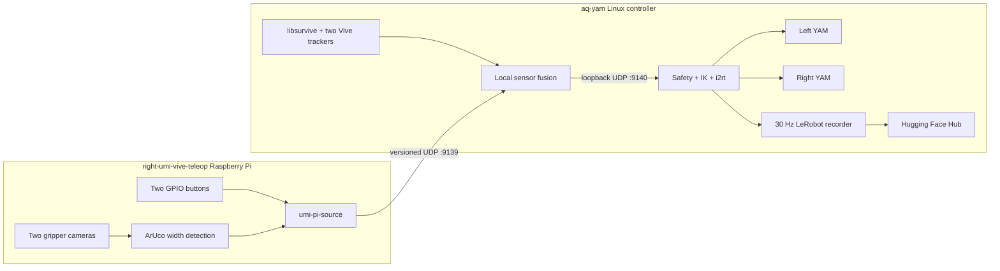

# UMI Teleop

Native Linux Vive teleoperation, GPIO control, ArUco gripper tracking, and optional LeRobot
dataset recording for two YAM arms. Windows, SteamVR, ROS, systemd, and SSH are not part of the
runtime data path.

> **Physical safety:** `umi-teleop --confirm-clear` opens both CAN-controlled robots and actively
> holds them. Clear the complete workspace, start with small tracker motions, and support both arms
> before quitting. Never connect or disconnect powered robot hardware.

## Architecture



The Pi packet repeats monotonic event counters, gripper widths, tag visibility, camera health,
sequence numbers, and a heartbeat. A dropped UDP packet cannot silently lose a button event.
Vive tracking, fusion, IK, and the 100 Hz robot loop remain local to `aq-yam`.

There are two operator-started programs:

- `umi-pi-source` runs on the Raspberry Pi and can remain running across sessions.
- `umi-teleop` runs on `aq-yam` for each teleoperation or recording session.

Both programs use Tyro dataclasses. Run either command with `--help` for every typed option. There
is no required configuration file and there are no background services. The current rig uses an
optional `.env` only as a shell shortcut for long hardware identities.

## Install The Raspberry Pi

```bash
sudo apt update
sudo apt install -y git curl v4l-utils python3-gi gir1.2-gstreamer-1.0 \
  gstreamer1.0-tools gstreamer1.0-plugins-base gstreamer1.0-plugins-good
curl -LsSf https://astral.sh/uv/install.sh | sh

git clone https://github.com/AfterQuery-Research/umi-teleop.git /home/aq/umi-teleop
cd /home/aq/umi-teleop
uv venv --python /usr/bin/python3 --system-site-packages
uv sync --locked --extra source --no-dev
```

The `aq` user must have access to the two V4L2 cameras and Raspberry Pi GPIO. On this rig it is a
member of `video` and `dialout`; `gpiozero` uses the `lgpio` backend automatically.

## Start The Raspberry Pi

Make both gripper tag pairs visible, then run in a Pi terminal:

```bash
cd /home/aq/umi-teleop
.venv/bin/umi-pi-source \
  --network.target-host aq-yam.local \
  --network.target-port 9139 \
  --left.device /dev/v4l/by-path/platform-xhci-hcd.1-usb-0:2:1.0-video-index0 \
  --left.calibration /home/aq/umi-teleop/src/umi_teleop/data/umi2_calib.npz \
  --left.tag-ids 2 3 \
  --right.device /dev/v4l/by-path/platform-xhci-hcd.0-usb-0:1:1.0-video-index0 \
  --right.calibration /home/aq/umi-teleop/src/umi_teleop/data/umi1_calib.npz \
  --right.tag-ids 0 1
```

Those values are the defaults for the current rig, so the equivalent short command is:

```bash
cd /home/aq/umi-teleop
.venv/bin/umi-pi-source
```

The process validates both camera devices, calibration files, GPIO pins, and both configured tag
pairs. It exits with a specific error if they do not become healthy within 20 seconds. Keep this
terminal open. After startup succeeds, a later tag occlusion is published as invalid telemetry
instead of terminating the Pi process; the aq-yam controller disarms until the tags recover. Press
`Ctrl+C` to stop only the Pi publisher.

Run a one-time camera/GPIO check without leaving the publisher online:

```bash
.venv/bin/umi-pi-source --preflight-only
```

Pass `--no-quiet` for once-per-second camera, detection, and packet diagnostics.

## Install aq-yam

```bash
sudo apt update
sudo apt install -y git curl build-essential cmake pkg-config can-utils \
  libusb-1.0-0-dev liblapacke-dev libopenblas-dev freeglut3-dev libx11-dev
sudo usermod -aG plugdev aq-yam
curl -LsSf https://astral.sh/uv/install.sh | sh

mkdir -p /home/aq-yam/Documents/Repos
git clone https://github.com/AfterQuery-Research/umi-teleop.git \
  /home/aq-yam/Documents/Repos/umi-teleop
cd /home/aq-yam/Documents/Repos/umi-teleop
uv sync --locked --extra yam --extra dataset --no-dev
./scripts/build-linux-vive.sh

sudo install -m 0644 config/udev/81-vive-watchman.rules \
  /etc/udev/rules.d/81-vive-watchman.rules
sudo udevadm control --reload-rules
sudo udevadm trigger
```

The udev rule grants access to Valve Watchman receivers. It does not start a process. Log out and
back in after changing groups, then reconnect the two Watchman dongles.

The current aq-yam rig has these optional shell exports in its ignored `.env`:

```bash
export ROBOT_ID=afterquery-dual-yam-01
export LEFT_CAN=209D378045465008
export RIGHT_CAN=206237A845465006
export TOP_CAMERA=262422074066
export LEFT_CAMERA=/dev/v4l/by-path/pci-0000:00:14.0-usb-0:3.4.4.1:1.0-video-index0
export RIGHT_CAMERA=/dev/v4l/by-path/pci-0000:00:14.0-usb-0:3.4.4.2:1.0-video-index0
```

These values can always be passed directly to `umi-teleop`; the file is not part of the runtime
protocol or a prerequisite for the CLI.

## Calibrate Vive Tracking

Plug in both base stations. Wake each Vive tracker with its center button and wait for a green
light. Place both trackers where both base stations can see them, then run:

```bash
cd /home/aq-yam/Documents/Repos/umi-teleop
.venv/bin/umi-vive-linux --calibrate
```

Wait for both base stations and tracker serials, then press `Ctrl+C`. Calibration is stored under
`~/.config/umi-teleop`. Recalibrate after moving a base station.

## Check CAN

```bash
cd /home/aq-yam/Documents/Repos/umi-teleop
.venv/bin/umi-setup-can \
  --left-adapter-serial 209D378045465008 \
  --right-adapter-serial 206237A845465006
```

Both interfaces must be UP, ERROR-ACTIVE, Classic CAN, and configured at `1000000` bit/s. This
command does not open a robot or send a motor command.

## Non-Moving Preflight

Leave the normal `umi-pi-source` process running, make the Vive trackers and all four ArUco tags
visible, then run on `aq-yam`:

```bash
cd /home/aq-yam/Documents/Repos/umi-teleop
.venv/bin/umi-teleop --preflight-only
```

Preflight checks exact Vive IDs, Pi source identity and heartbeat, camera/tag freshness, protocol
compatibility, both CAN adapters, competing controller processes, IK dependencies, dataset cameras,
disk space, and Hugging Face authentication when upload is enabled. It never constructs a robot.

## Run Teleoperation

With the Pi publisher already running:

```bash
cd /home/aq-yam/Documents/Repos/umi-teleop
.venv/bin/umi-teleop --confirm-clear
```

The repository-defined all-zero base pose is a poor Cartesian IK starting posture. If either arm
is parked there, explicitly request the slow, unrecorded bent startup pose after clearing the full
workspace:

```bash
.venv/bin/umi-teleop --robot.move-to-ready --confirm-clear
```

This motion is never implicit. Without `--robot.move-to-ready`, both arms hold their physical
starting pose until ZERO and RECORD. The startup move must finish and verify before ZERO can arm
teleoperation, and dataset recording does not begin until RECORD is tapped afterward.

The current hardware defaults are:

| Role | Runtime identity |
|---|---|
| Pi source | `right-umi-vive-teleop.local` |
| Left Vive tracker | `LHR-BBAF093A` |
| Right Vive tracker | `LHR-C891E882` |
| Left CAN adapter | `209D378045465008` |
| Right CAN adapter | `206237A845465006` |

Every identity can be supplied at runtime:

```bash
.venv/bin/umi-teleop \
  --pi.source-host right-umi-vive-teleop.local \
  --tracking.left-id LHR-BBAF093A \
  --tracking.right-id LHR-C891E882 \
  --robot.left-can-serial 209D378045465008 \
  --robot.right-can-serial 206237A845465006 \
  --confirm-clear
```

## GPIO User Interface

The Raspberry Pi buttons are the primary interface:

| Gesture | Result |
|---|---|
| Tap ZERO | Disarm, wait for fresh poses, and capture the tracker/robot reference |
| Tap RECORD after ZERO | Confirm fresh sensors, start teleoperation, and start an episode |
| Tap RECORD while active | Disarm immediately and save the episode |
| Hold RECORD | Disarm immediately and discard the active episode |
| Hold ZERO/QUIT | Disarm, finalize local data, optionally upload, and shut down aq-yam control |

Normal sequence:

1. Start `umi-pi-source` and then `umi-teleop`.
2. Hold both UMI handles at the desired neutral pose.
3. Tap ZERO and wait for `zero captured`.
4. Tap RECORD and wait for `enabled` and `DATASET episode started` when recording.
5. Teleoperate with small motions first.
6. Tap RECORD again to stop and save.
7. Hold ZERO/QUIT when finished, then support both arms before the controller releases them.

Starting before ZERO is rejected. Tracking or Pi recovery never re-arms automatically.

For unattended bench diagnostics, opt in to a loopback-only software control channel by adding
`--debug.enable` to `umi-teleop`. Physical Pi GPIO remains active, and another `aq-yam` shell can
then issue deterministic commands:

```bash
umi-teleop-control status
umi-teleop-control zero
umi-teleop-control start
umi-teleop-control stop
umi-teleop-control cancel
umi-teleop-control quit
```

This interface is disabled by default, binds only to `127.0.0.1`, and still passes through the same
ZERO, quiet-period, sensor-freshness, IK, and disarm checks as GPIO. It is for supervised testing,
not remote production control.

## Record And Upload A Dataset

Authenticate once on `aq-yam` without putting a token in shell history:

```bash
hf auth login
```

The current rig uses one top RealSense and two side global-shutter cameras. The `.env` file on
`aq-yam` contains their stable identities. A complete command is:

```bash
cd /home/aq-yam/Documents/Repos/umi-teleop
source .env
.venv/bin/umi-teleop \
  --dataset.record \
  --dataset.repo-id AfterQuery-Research/REPLACE_ME \
  --dataset.root /home/aq-yam/datasets/REPLACE_ME \
  --dataset.task "Describe the manipulation task" \
  --dataset.top-camera-serial "$TOP_CAMERA" \
  --dataset.side-camera-kind ultrawide \
  --dataset.left-camera-path "$LEFT_CAMERA" \
  --dataset.right-camera-path "$RIGHT_CAMERA" \
  --dataset.push-to-hub \
  --dataset.private \
  --confirm-clear
```

Before a physical recording session, run the same configuration with `--preflight-only` and omit
`--confirm-clear`. This opens and reads all three dataset cameras, validates storage and Hub login,
and checks the sensor/CAN/IK path without constructing either robot:

```bash
cd /home/aq-yam/Documents/Repos/umi-teleop
source .env
.venv/bin/umi-teleop \
  --preflight-only \
  --dataset.record \
  --dataset.repo-id AfterQuery-Research/REPLACE_ME \
  --dataset.root /home/aq-yam/datasets/REPLACE_ME \
  --dataset.task "Describe the manipulation task" \
  --dataset.top-camera-serial "$TOP_CAMERA" \
  --dataset.side-camera-kind ultrawide \
  --dataset.left-camera-path "$LEFT_CAMERA" \
  --dataset.right-camera-path "$RIGHT_CAMERA" \
  --dataset.push-to-hub \
  --dataset.private
```

The robot loop remains at 100 Hz. Latest-target IK runs in per-arm background workers by default,
so a numerical solve cannot stall sensor checks, command interpolation, or the recorder. The
recorder samples synchronized observations and dispatched actions at the MolmoAct2-compatible 30
Hz rate and performs resizing, encoding, and disk writes on bounded background workers. Stopping
holds the current pose by default. Use
`--dataset.post-episode-action neutral` only when an automatic return is intentionally desired.

Uploads happen after robot control closes. If upload fails, the finalized local dataset remains
unchanged and the terminal prints an `umi-dataset-upload` recovery command.

## Control Tuning

```bash
.venv/bin/umi-teleop \
  --control.position-scale 2.0 \
  --control.rotation-scale 1.0 \
  --control.max-joint-speed 1.0 \
  --control.max-joint-acceleration 8.0 \
  --control.translation-filter-hz 18 \
  --control.rotation-filter-hz 15 \
  --control.translation-deadband-m 0.001 \
  --control.rotation-deadband-deg 0.25 \
  --confirm-clear
```

Higher filter cutoffs respond faster but pass more tracking noise. Lower cutoffs are smoother but
add lag. Position and rotation scales change tracker sensitivity. Joint speed and acceleration
bound the robot response independently of tracker motion. Workspace limits remain enforced after
scaling and filtering.

Native tracking uses the pinned `collabora/libsurvive` build in `scripts/build-linux-vive.sh`.
The launcher selects libsurvive's `KalmanOnly` poser by default because it produced stable,
low-latency dual-tracker output on the aq-yam host; `MPFIT` remains available through
`--tracking.poser MPFIT` for simulation or preflight diagnostics, but the physical launcher rejects
it. Unsupported poser names fail validation. The native sender logs validity transitions with pose
age, continuity, and rejection counters; startup acquisition is expected, while any later invalid
transition is actionable tracking evidence.
Before fusion, it rejects non-monotonic or physically impossible pose steps (defaults: `8 m/s`
and `1440 deg/s`) and publishes that tracker as invalid until `250 ms` of plausible samples have
arrived. These thresholds can be changed with `--tracking.max-linear-speed-m-s`,
`--tracking.max-angular-speed-deg-s`, and `--tracking.reacquire-ms`; increasing them weakens the
first tracking safety boundary. Independently, the controller invalidates ZERO if a tracker moves
more than `0.75 m` or `150 deg` from the captured reference.

At startup, the launcher listens directly to native tracking before it starts fusion or the robot
controller. Both configured serials must remain valid for `0.75 s`. An intermittent tracker-only
startup is retried up to three times while no controller process exists; after fusion starts, no
child is automatically restarted. Tune this bounded pre-control gate with
`--tracking.startup-timeout-s`, `--tracking.startup-stable-s`, and
`--tracking.startup-attempts`.

## Safety Behavior

- Missing or duplicate hardware identities fail before robot construction.
- A new source or controller session always requires a new ZERO.
- Stale Vive poses, Pi heartbeat, camera frames, ArUco widths, control packets, or IK results disarm.
- A libsurvive discontinuity publishes an invalid pose during stable reacquisition; a large change
  from the captured reference invalidates ZERO and requires the operator to tap ZERO again.
- Camera or tag loss while active disarms both arms, not only the gripper command.
- GPIO cancel, quit, and stop are immediate; enabling requires a quiet fresh-sensor interval.
- Joint limits, workspace limits, command speed, command acceleration, CAN state, and competing
  robot controllers are checked fail-closed.
- A direct IK miss uses bounded fallback targets; exhausting every fallback disarms both arms and
  requires a fresh RECORD off/on sequence before motion can resume.
- Dataset camera or writer failure disarms and discards the affected episode.
- No child process is automatically restarted during physical control. Any child exit shuts down
  the launcher and its remaining children.

Use `--no-quiet` for detailed timing and packet diagnostics. Normal logging reports startup,
state transitions, warnings, episode results, and errors only.

## Troubleshooting

| Message | Check |
|---|---|
| `Pi preflight timed out` | Both Pi camera paths, both calibration files, and tags `0 1 2 3` are visible |
| `tracking stale` | Both Vive trackers are green, visible to the base stations, and use the configured serials |
| `continuity lost` | Improve tracker/base-station visibility and check Watchman USB/radio stability; wait for both trackers to reacquire, then tap ZERO again |
| `tracking frame changed after ZERO` | Do not enable; hold both handles neutral and tap ZERO again after tracking is stable |
| `Pi heartbeat` or `unexpected source` | The Pi hostname resolves from aq-yam and UDP port `9139` is not blocked |
| `camera preflight failed` | The top serial and both stable V4L2 paths are correct and unused by another process |
| `CAN identity` or `CAN interface ... DOWN` | Run `umi-setup-can` and verify each USB serial is assigned to the intended arm |
| `Hugging Face authentication failed` | Run `hf auth login`; never put a token on the `umi-teleop` command line |
| `DATASET upload failed` | Keep the local dataset and run the printed `umi-dataset-upload` recovery command |

After a child failure, `umi-teleop` stops only the children it launched. Fix the reported cause,
confirm no controller remains, and rerun preflight before starting another physical session.

To inspect native tracking without opening CAN or starting the robot controller, run the native
sender and checker in separate aq-yam terminals:

```bash
.venv/bin/umi-vive-linux --target-host 127.0.0.1 --target-port 9001 --rate-hz 120
scripts/check-linux-vive-stream.py --duration-s 30 \
  --expect-serial LHR-BBAF093A --expect-serial LHR-C891E882
```

The checker fails on new continuity resets, rejected samples, timecode regressions, implausible
rates, missing trackers, malformed packets, or insufficient valid-pose coverage.

## Development

```bash
uv sync --locked --group dev
uv run ruff format --check .
uv run ruff check .
uv run pytest
uv build
```

The test suite covers Tyro parsing, packet validation, event-counter recovery, GPIO state changes,
camera health, stale inputs, filtering, safety envelopes, CAN identity, IK behavior, 100-to-30 Hz
recording decimation, dataset lifecycle, upload recovery, and a Linux two-process localhost
preflight using simulated Pi sensors, Vive trackers, and YAMs.
