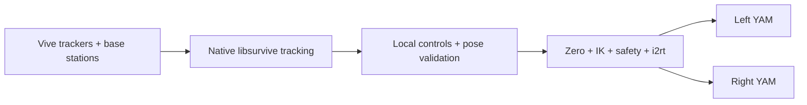

# UMI Teleop

Native Linux Vive teleoperation for two UMI trackers and two YAM arms. The complete test runs on
`aq-yam`; Windows and the UMI Pi are not used.

> **Physical safety:** `umi-teleop --confirm-clear` energizes both arms and holds their current
> positions. Clear the complete workspace first. Support both arms before quitting because stopping
> the controller releases active holding. Never connect or disconnect powered hardware.

## How It Runs



One `umi-teleop` command supervises all three local processes. Tracker packets use loopback UDP
`127.0.0.1:9001`; validated controls use loopback UDP `127.0.0.1:9140`. No SSH or external network
traffic is involved in the live control path.

This test mode:

- controls arm position and orientation only;
- holds each gripper at its measured startup position;
- does not open UMI cameras or use ArUco tags;
- does not record, save, or upload a dataset;
- does not use systemd, Steam, SteamVR, Windows, or the UMI Pi.

## Fixed Hardware

| Role | Identity |
|---|---|
| Host | `aq-yam@aq-yam.local` |
| Left UMI tracker | `LHR-BBAF093A` |
| Right UMI tracker | `LHR-C891E882` |
| Left YAM CAN adapter | `209D378045465008` |
| Right YAM CAN adapter | `206237A845465006` |

CAN adapters are resolved by USB serial, so the setup remains correct if Linux changes their
`can0`/`can1` names.

## Install Once

Run on `aq-yam`:

```bash
sudo apt update
sudo apt install -y git curl build-essential cmake pkg-config can-utils \
  libusb-1.0-0-dev liblapacke-dev libopenblas-dev freeglut3-dev libx11-dev
sudo usermod -aG plugdev aq-yam

curl -LsSf https://astral.sh/uv/install.sh | sh
mkdir -p /home/aq-yam/Documents/Repos
git clone https://github.com/AfterQuery-Research/umi-teleop.git \
  /home/aq-yam/Documents/Repos/umi-teleop
cd /home/aq-yam/Documents/Repos/umi-teleop

uv sync --locked --extra yam --no-dev
./scripts/build-linux-vive.sh

sudo install -m 0644 config/udev/81-vive-watchman.rules \
  /etc/udev/rules.d/81-vive-watchman.rules
sudo udevadm control --reload-rules
sudo udevadm trigger
```

Log out and back in after the `plugdev` group change, then replug the Watchman receivers. The udev
rule only grants device access; it does not start anything.

The `yam` extra pins the same tested AfterQuery `i2rt` commit used by the LeRobot dual-YAM setup,
including its multi-turn gripper encoder-wrap fix.

## Calibrate Tracking Once

Plug in and power both base stations. Press the center button on each Vive tracker and wait for a
green light. Put the trackers on a stationary surface visible to both base stations, then run:

```bash
cd /home/aq-yam/Documents/Repos/umi-teleop
.venv/bin/umi-vive-linux --calibrate
```

Wait until libsurvive decodes both base stations, solves the global scene, and reports all tracker
serials. Press Ctrl+C. The result is stored under `~/.config/umi-teleop`. Recalibrate only after a
base station moves.

## Check CAN

List the adapters without opening CAN or sending frames:

```bash
cd /home/aq-yam/Documents/Repos/umi-teleop
.venv/bin/umi-setup-can
```

For this rig the output must map the left serial to one interface and the right serial to the other.
Both must be UP, Classic CAN, at `1000000` bit/s. If they are not ready after a reboot or replug:

```bash
.venv/bin/umi-setup-can \
  --left-adapter-serial 209D378045465008 \
  --right-adapter-serial 206237A845465006
```

This command only configures and verifies SocketCAN. It does not import `i2rt`, send motor frames,
or move an arm.

## Run Teleoperation

Wake the two control trackers and clear the complete arm workspace. Run one command:

```bash
cd /home/aq-yam/Documents/Repos/umi-teleop
.venv/bin/umi-teleop --confirm-clear
```

The test launcher defaults to a low-latency profile: `2.0x` translation sensitivity, a `1.0 rad/s`
per-joint speed limit, `120 Hz` tracking/source loops, a `100 Hz` controller loop, and synchronous
normal-path IK. Override values at startup when a slower profile is needed:

```bash
.venv/bin/umi-teleop --confirm-clear \
  --position-scale 1.5 --max-joint-speed 0.45 \
  --tracking-hz 60 --source-hz 60 --controller-hz 50 --no-synchronous-ik
```

Wait for fresh left and right pose ages and:

```text
robots holding current pose; request ZERO before enable
```

Type each key in this same terminal and press Enter:

| Key | Action |
|---|---|
| `Z` | Stop and capture the current UMI and robot positions as zero |
| `E` | Start teleoperation after a short fresh-tracking confirmation |
| `S` | Stop teleoperation immediately and keep holding the arms |
| `Q` | Quit all local processes |
| `C` | Emergency cancel; equivalent to an immediate safety disarm |

The normal sequence is:

1. Hold both UMIs at the desired neutral pose.
2. Type `Z`, press Enter, and wait for `zero captured`.
3. Type `E`, press Enter, and wait for `enabled`.
4. Teleoperate with small motions first.
5. Type `S` and press Enter to stop teleoperating.
6. Support both arms, then type `Q` and press Enter to release holding and quit.

There is no recording in this test launcher. `S` only stops robot teleoperation.

## Safety Behavior

- A new run always requires a new `Z` before `E` can arm.
- `Z`, `S`, `C`, stale tracking, stale packets, or a restarted source disarms immediately.
- Neither stale data nor tracking recovery can re-arm the robot automatically.
- Raw UMI translation is limited to `0.50 m` and rotation to `90 deg` from zero.
- Joint limits, command slew limits, CAN state, IK result age, and competing controllers are checked.
- Exact IK failure holds the last safe target and retries; it never sends an unvalidated target.
- Automatic startup motion is disabled. The launcher does not pass `--move-to-ready` or
  `--move-to-base`.

The launcher reads `LEFT_CAN` and `RIGHT_CAN` environment variables when present; otherwise it uses
the fixed serials above. It refuses physical startup unless `--confirm-clear` is supplied.

## Diagnostics

Measure native tracking without starting the source or controller:

```bash
.venv/bin/umi-vive-linux &
VIVE_PID=$!
./scripts/check-linux-vive-stream.py \
  --expect-serial LHR-BBAF093A \
  --expect-serial LHR-C891E882
kill -INT "$VIVE_PID"
wait "$VIVE_PID"
```

Exercise the complete launcher with simulated YAMs and no CAN access:

```bash
.venv/bin/umi-teleop --simulate
```

If a tracker becomes stale, stop with `S`, restore visibility to both base stations, then use a new
`Z` followed by `E`. If CAN is missing, down, in CAN FD mode, or at the wrong bitrate, stop all robot
controllers and rerun `umi-setup-can` with the two fixed serials.

## Development

```bash
uv sync --locked --group dev
uv run ruff format --check .
uv run ruff check .
uv run pytest
uv build
```

The tests cover native and legacy tracker packets, explicit tracking loss, sensor age, deterministic
controls, one-command launch configuration, arm-only zero/enable/stop behavior, loopback transport,
CAN identity and readiness, Cartesian and joint safety, IK fallback, and I2RT compatibility.
