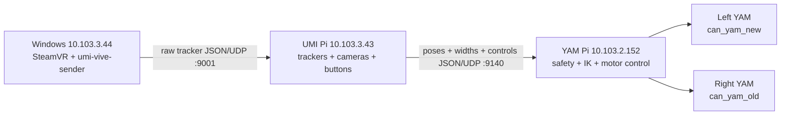

# UMI Teleop

Standalone Vive teleoperation for two camera-equipped UMIs and two YAM robot arms.

> **Physical safety:** `umi-yam --confirm-clear` energizes both arms and moves them automatically.
> Clear the complete workspace first. Stopping the process releases active holding, so support the
> arms before pressing Ctrl+C. Never connect or disconnect powered hardware.

## Architecture



The Windows sender publishes raw SteamVR poses. The UMI Pi converts them to `+X` forward, `+Y`
left, `+Z` up; measures both grippers from calibrated ArUco tags; reads the E/Z buttons; and sends
one validated packet at 30 Hz. The YAM Pi owns zeroing, workspace limits, inverse kinematics, joint
limits, slew limits, CAN access, and motor commands. Images never leave the UMI Pi.

One root `pyproject.toml` and lockfile keep the protocol and safety code on one version. Install only
the relevant hardware extra on each device: `windows`, `source`, or `yam`. Every CLI uses Tyro;
run any command with `--help` to override its typed defaults.

## Fixed Setup

| Role | Address / mapping |
|---|---|
| Windows SteamVR host | `aq@10.103.3.44` |
| UMI source Pi | `aq@10.103.3.43`, receives UDP `9001`, sends to `10.103.2.152:9140` |
| YAM controller Pi | `yam@10.103.2.152`, receives UDP `9140` |
| Left leader | UMI2, tracker `LHR-BBAF093A`, camera tags `2/3` |
| Right leader | UMI1, tracker `LHR-C891E882`, camera tags `0/1` |
| Left follower | `can_yam_new` |
| Right follower | `can_yam_old` |

The calibrated camera files and the safe I2RT gripper encoder-wrap correction are included in this
repository. No `robot-umi`, `vive-tracking`, `gello`, or patched I2RT checkout is required.

## Install

All three devices must clone the same commit from the private repository:

```text
https://github.com/AfterQuery-Research/umi-teleop.git
```

### Windows SteamVR host

In PowerShell, install [uv](https://docs.astral.sh/uv/getting-started/installation/), then:

```powershell
git clone https://github.com/AfterQuery-Research/umi-teleop.git C:\umi-teleop
cd C:\umi-teleop
uv sync --locked --extra windows --no-dev
```

SteamVR and both trackers must be visible before starting the sender.

### UMI source Pi

The source uses system GStreamer/PyGObject for both USB cameras and its own uv environment for the
rest:

```bash
sudo apt update
sudo apt install -y git curl v4l-utils python3-gi gir1.2-gstreamer-1.0 \
  gstreamer1.0-tools gstreamer1.0-plugins-base gstreamer1.0-plugins-good
sudo usermod -aG video,dialout aq
curl -LsSf https://astral.sh/uv/install.sh | sh
git clone https://github.com/AfterQuery-Research/umi-teleop.git /home/aq/umi-teleop
cd /home/aq/umi-teleop
uv venv --python /usr/bin/python3 --system-site-packages
uv sync --locked --extra source --no-dev
```

Reconnect to the Pi once after changing group membership.

Do not run the old recorder, Vive receiver, or button programs at the same time. They share UDP
port `9001`, GPIO `17/27`, and both cameras with `umi-source`.

### YAM controller Pi

```bash
sudo apt update
sudo apt install -y git curl build-essential cmake ninja-build can-utils
curl -LsSf https://astral.sh/uv/install.sh | sh
git clone https://github.com/AfterQuery-Research/umi-teleop.git /home/yam/umi-teleop
cd /home/yam/umi-teleop
uv sync --locked --extra yam --no-dev
```

Before real operation, both CAN interfaces must exist, be `UP`, report `ERROR-ACTIVE`, and have
zero bus-error counters:

```bash
ip -details -statistics link show can_yam_new
ip -details -statistics link show can_yam_old
```

## Bring Up

1. Power the Pis and YAMs. Start SteamVR and wake both trackers.
2. On Windows, start tracker streaming:

   ```powershell
   cd C:\umi-teleop
   .\.venv\Scripts\umi-vive-sender.exe
   ```

3. In a dedicated terminal, start the UMI source and inspect its live health:

   ```bash
   ssh -t aq@10.103.3.43 \
     'cd /home/aq/umi-teleop && GPIOZERO_PIN_FACTORY=lgpio .venv/bin/umi-source'
   ```

   Keep this terminal open. Continue only when its logs show `enabled=False`, left/right
   `pose_age` and `width_age` below `0.5`, nonempty left/right `width_mm`, and `bad_vive=0`.

4. Clear the full arm workspace. In a dedicated terminal, start the YAM controller:

   ```bash
   ssh -t yam@10.103.2.152 \
     'cd /home/yam/umi-teleop && .venv/bin/umi-yam --confirm-clear'
   ```

   It refuses competing controllers, validates both CAN buses, waits for fresh disabled telemetry,
   and slowly moves both arms through a bent posture to `[0, 23, 46, 0, 0, 0]` degrees. Wait for:

   ```text
   robots holding current pose; tap the Pi ZERO button before enable
   ```

5. Hold both UMIs in the intended neutral pose, especially the right UMI, then:
   - Tap **Z** once.
   - Wait at least **5 seconds** for the post-zero enable cooldown.
   - Tap **E** once and keep the UMIs steady during the 3-second enable confirmation.
   - Begin with small motions.

The right UMI orientation at Z defines the shared command axes. Each arm otherwise follows its own
leader's position/orientation change from Z. Translation is scaled `1.5x`; the input envelope is
`0.40 m` and `90 deg`; joint speed is limited to `0.45 rad/s`.

## Controls

| Control | Action |
|---|---|
| E tap while disabled | Request enable; commits after 3 quiet seconds with fresh poses and widths |
| E tap while enabled | Disable immediately and hold the last commanded robot pose |
| E hold for 1 second | Cancel/disarm immediately |
| Z tap | Disable, wait 0.4 seconds for fresh poses, then capture a new zero |
| Z hold for 1 second | Ask the source and YAM controller to quit |

A new source process always creates a new session ID, so the YAM controller requires a new Z before
it can enable. Z can be used again during a session; it disarms first and captures the current UMI
and robot poses as the next references.

## Stop

1. Tap **E** once if the source is enabled; verify `enabled=False` in the source log.
2. Support both YAM arms, then press Ctrl+C in the `umi-yam` terminal. Torque holding is released.
3. Press Ctrl+C in the UMI source terminal.

4. Press Ctrl+C in the Windows sender, then power down hardware.

## Recovery

- **Startup says the source is enabled:** tap E once to disable it, verify `enabled=False`, and rerun
  `umi-yam --confirm-clear`.
- **Vive or width telemetry is stale:** make both trackers visible and both ArUco tag pairs visible;
  do not enable until both ages recover.
- **YAM controller disarms while the source still says enabled:** tap E once to synchronize the
  source back to disabled. To continue from the current robot pose, hold the UMIs neutral, tap Z,
  wait 5 seconds, then tap E. To return to the canonical posture, disable, support the arms, stop the
  controller, clear the workspace, and rerun it.
- **IK fails five consecutive cycles, a workspace limit is exceeded, packets go stale, or a joint
  target approaches its limit:** the controller disarms and holds its last command. It never
  automatically rearms.
- **Inspect packets without motors:** run `.venv/bin/umi-yam --monitor-only` on the YAM Pi.

## Development Verification

```bash
uv sync --locked --group dev
uv run ruff format --check .
uv run ruff check .
uv run pytest
uv build
```

The test suite covers SteamVR packet construction, OpenVR coordinate conversion, strict protocol
validation, GPIO state guards, camera buffering, calibrated ArUco geometry, zero/enable/session
behavior, Cartesian limits, gripper mapping, the I2RT encoder-wrap correction, and a UDP integration
test across the Windows, source, and YAM layers.
