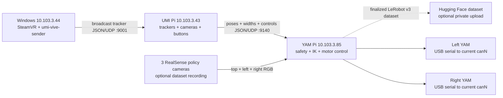

# UMI Teleop

Standalone Vive teleoperation for two camera-equipped UMIs and two YAM robot arms.

> **Physical safety:** `umi-yam --confirm-clear` energizes both arms and holds their current joint
> positions. Automatic startup motion is opt-in through `--move-to-ready` or `--move-to-base`.
> Clear the complete workspace first. Stopping the process releases active holding, so support the
> arms before pressing Ctrl+C. Never connect or disconnect powered hardware.

## Architecture



The Windows sender broadcasts raw SteamVR poses to UDP port `9001`, so the UMI Pi and monitoring
computers on the same local network can receive the stream simultaneously. The UMI Pi converts
poses to `+X` forward, `+Y` left, `+Z` up; measures both grippers from calibrated ArUco tags; reads
the E/Z buttons; and sends one validated packet at 30 Hz. The YAM Pi owns zeroing, workspace limits,
inverse kinematics, joint limits, slew limits, CAN access, and motor commands. The two UMI
ArUco-camera images never leave the UMI Pi. Optional policy-dataset images come from three separate
RealSense cameras connected to the YAM Pi and leave it only when explicit Hub upload is enabled.

One root `pyproject.toml` and lockfile keep the protocol and safety code on one version. Install only
the relevant hardware extra on each device: `windows`, `source`, or `yam`. Every CLI uses Tyro;
run any command with `--help` to override its typed defaults.

## Fixed Setup

| Role | Address / mapping |
|---|---|
| Windows SteamVR host | `aq@10.103.3.44`, broadcasts raw poses on UDP `9001` |
| UMI source Pi | `aq@10.103.3.43`, receives UDP `9001`, sends to `10.103.3.85:9140` |
| YAM controller Pi | `yam@10.103.3.85`, receives UDP `9140` |
| Left leader | UMI2, tracker `LHR-BBAF093A`, camera tags `2/3` |
| Right leader | UMI1, tracker `LHR-C891E882`, camera tags `0/1` |
| Left follower | CAN adapter USB serial selected at startup |
| Right follower | CAN adapter USB serial selected at startup |

The calibrated camera files and the safe I2RT gripper encoder-wrap correction are included in this
repository. No `robot-umi`, `vive-tracking`, `gello`, or patched I2RT checkout is required.

## Install

All three devices must clone the same commit from the private repository:

```text
https://github.com/AfterQuery-Research/umi-teleop.git
```

### Windows SteamVR host

In PowerShell, install [uv](https://docs.astral.sh/uv/getting-started/installation/), then:

```powershell
git clone https://github.com/AfterQuery-Research/umi-teleop.git C:\umi-teleop
cd C:\umi-teleop
uv sync --locked --extra windows --no-dev
```

Before starting the sender:

1. Plug in and power on both Vive base stations.
2. Press the center button on each Vive tracker.
3. Wait for each tracker light to turn green. Green means the tracker is paired and connected.
4. Confirm that both trackers appear in SteamVR on Windows.

### UMI source Pi

The source uses system GStreamer/PyGObject for both USB cameras and its own uv environment for the
rest:

```bash
sudo apt update
sudo apt install -y git curl v4l-utils python3-gi gir1.2-gstreamer-1.0 \
  gstreamer1.0-tools gstreamer1.0-plugins-base gstreamer1.0-plugins-good
sudo usermod -aG video,dialout aq
curl -LsSf https://astral.sh/uv/install.sh | sh
git clone https://github.com/AfterQuery-Research/umi-teleop.git /home/aq/umi-teleop
cd /home/aq/umi-teleop
uv venv --python /usr/bin/python3 --system-site-packages
uv sync --locked --extra source --no-dev
```

Reconnect to the Pi once after changing group membership.

Do not run the old recorder, Vive receiver, or button programs at the same time. They share UDP
port `9001`, GPIO `17/27`, and both cameras with `umi-source`.

### YAM controller Pi

```bash
sudo apt update
sudo apt install -y git curl build-essential cmake ninja-build can-utils
curl -LsSf https://astral.sh/uv/install.sh | sh
mkdir -p /home/yam/Documents/Repos
git clone https://github.com/AfterQuery-Research/umi-teleop.git \
  /home/yam/Documents/Repos/umi-teleop
cd /home/yam/Documents/Repos/umi-teleop
uv sync --locked --extra yam --no-dev
```

To record MolmoAct2-compatible LeRobot datasets on this computer, install the optional Python
3.12 recording stack as well:

```bash
uv sync --locked --extra yam --extra dataset --no-dev
```

This adds LeRobot's dataset writer and RealSense support only on the YAM computer. It is not
needed on Windows or the UMI source Pi.

#### Discover and configure CAN

Stop robot-control processes, then list the adapters without opening a CAN bus or sending frames:

```bash
cd /home/yam/Documents/Repos/umi-teleop
.venv/bin/umi-setup-can
```

The USB serial identifies an adapter even if Linux changes its `canN` name. Determine which cable
goes to each arm and label it. Never connect or disconnect powered CAN hardware. If an adapter must
be connected by itself to establish the mapping, first shut down the Pi and remove YAM power.

Set the installation's left and right serials in the YAM shell. Replace the two example names with
the serials reported above:

```bash
export LEFT_CAN=LEFT_ADAPTER_USB_SERIAL
export RIGHT_CAN=RIGHT_ADAPTER_USB_SERIAL
```

Configure both adapters after every reboot or replug:

```bash
.venv/bin/umi-setup-can \
  --left-adapter-serial "$LEFT_CAN" \
  --right-adapter-serial "$RIGHT_CAN"

ip -details -statistics link show type can
```

This performs only `ip link` setup and verification. It does not import i2rt, open a CAN bus, send
motor frames, or move the robot. Both links must report `UP`, Classic CAN at `1000000` bit/s, and
`ERROR-ACTIVE`. You do not need to repeat setup before each run unless the Pi rebooted or an adapter
was replugged.

## Bring Up

1. Power the Pis and YAMs. Start SteamVR and wake both trackers.
2. On Windows, start tracker streaming:

   ```powershell
   cd C:\umi-teleop
   .\.venv\Scripts\umi-vive-sender.exe
   ```

   The default destination is the local broadcast address `255.255.255.255`, allowing any receiver
   bound to UDP `9001` on the same broadcast network to consume the packets. Use `--target-host`
   only when a specific unicast destination is required. The UDP stream is unauthenticated and
   unencrypted, so broadcast it only on a trusted local network.

3. In a dedicated terminal, start the UMI source and inspect its live health:

   ```bash
   ssh -t aq@10.103.3.43 \
     'cd /home/aq/umi-teleop && GPIOZERO_PIN_FACTORY=lgpio .venv/bin/umi-source'
   ```

   Keep this terminal open. Continue only when its logs show `enabled=False`, left/right
   `pose_age` and `width_age` below `0.5`, nonempty left/right `width_mm`, and `bad_vive=0`.

4. Put both arms in the intended base pose and clear the full arm workspace. In a dedicated
   terminal, connect to the YAM Pi, set the same two adapter serials used during CAN setup, and
   start the controller:

   ```bash
   ssh -t yam@10.103.3.85
   cd /home/yam/Documents/Repos/umi-teleop
   export LEFT_CAN=LEFT_ADAPTER_USB_SERIAL
   export RIGHT_CAN=RIGHT_ADAPTER_USB_SERIAL
   .venv/bin/umi-yam \
     --left-adapter-serial "$LEFT_CAN" \
     --right-adapter-serial "$RIGHT_CAN" \
     --confirm-clear
   ```

   It resolves each USB serial to its current `canN` name, refuses competing controllers, validates
   both CAN buses, waits for fresh telemetry, energizes the arms, and holds their current positions.
   It does not command a startup trajectory unless `--move-to-ready` or `--move-to-base` is passed
   explicitly. Wait for:

   ```text
   robots holding current pose; tap the Pi ZERO button before enable
   ```

5. Hold both UMIs in the intended neutral pose, especially the right UMI, then:
   - Tap **Z** once.
   - Wait at least **5 seconds** for the post-zero enable cooldown.
   - Tap **E** once and keep the UMIs steady during the 3-second enable confirmation.
   - Begin with small motions.

The right UMI orientation at Z defines the shared command axes. Each arm otherwise follows its own
leader's position/orientation change from Z. Translation is scaled `1.5x`; the input envelope is
`0.50 m` and `90 deg`; joint speed is limited to `0.45 rad/s`. At the envelope, the controller
projects the raw UMI delta onto the boundary and stays armed. This permits up to `0.75 m` of scaled
robot translation while preventing a larger raw motion from producing an unbounded target.

## Controls

| Control | Action |
|---|---|
| E tap while disabled | Request enable; commits after 3 quiet seconds with fresh poses and widths |
| E tap while enabled | Disable immediately; a recording run saves, then returns both arms to base |
| E hold for 1 second | Cancel/disarm immediately |
| Z tap | Disable, wait 0.4 seconds for fresh poses, then capture a new zero |
| Z hold for 1 second | Ask the source and YAM controller to quit |

A new source process always creates a new session ID, so the YAM controller requires a new Z before
it can enable. Z can be used again during a session; it disarms first and captures the current UMI
and robot poses as the next references.

## Record A LeRobot Dataset

Recording is optional and runs inside `umi-yam`, which remains the only process allowed to own the
YAM CAN buses. Do not run `lerobot-record`, policy inference, or another `umi-yam` at the same time.
The UMI source Pi keeps owning its two ArUco cameras; the YAM computer separately owns three
RealSense policy cameras.

First discover and identify the RealSense cameras from the LeRobot checkout:

```bash
cd /home/yam/Documents/Repos/lerobot
uv run lerobot-find-cameras realsense
```

Inspect the saved previews, then assign three distinct serials in the fixed MolmoAct2 view order:

```bash
export TOP_CAMERA=TOP_REALSENSE_SERIAL
export LEFT_CAMERA=LEFT_REALSENSE_SERIAL
export RIGHT_CAMERA=RIGHT_REALSENSE_SERIAL
```

The top D435 is captured at RGB `640x480` at 30 Hz, center-cropped to `640x360`, and downsampled to
`480x270`. The left and right D405 cameras are captured natively at RGB `480x270` at 30 Hz. This
keeps the same 16:9 views while reducing encoder load; the MolmoAct2 checkpoint resizes each view to
its `378x378` image input. Recording validates and opens all three before it opens CAN or constructs
either robot, and requires at least 5 GiB of free dataset storage before each episode. Authenticate
once before requesting upload; the token stays in Hugging Face's normal credential store and is
never passed to `umi-yam`:

```bash
cd /home/yam/Documents/Repos/umi-teleop
.venv/bin/hf auth login
```

Choose a new Hub repository ID and a local path that does not exist yet, clear the robot workspace,
then run:

```bash
.venv/bin/umi-yam \
  --left-adapter-serial "$LEFT_CAN" \
  --right-adapter-serial "$RIGHT_CAN" \
  --dataset.repo-id AfterQuery-Research/YOUR_DATASET_NAME \
  --dataset.root /home/yam/Datasets/YOUR_DATASET_NAME \
  --dataset.task "Pick up the oranges and put them in the bowl" \
  --dataset.top-camera-serial "$TOP_CAMERA" \
  --dataset.left-camera-serial "$LEFT_CAMERA" \
  --dataset.right-camera-serial "$RIGHT_CAMERA" \
  --dataset.streaming-encoding \
  --dataset.push-to-hub \
  --confirm-clear
```

The default launch does not command or record a startup trajectory. Recording begins on the first
successful E enable. Tapping E to stop saves the episode, then automatically returns both arms to
the all-zero base posture without recording the return. The previous Cartesian ZERO is invalidated;
after the terminal prints `robots at unrecorded base pose`, place the UMIs at their next neutral
poses, tap Z, wait for the cooldown, and tap E to record another episode without restarting any
process. The idle wait for ZERO/E is not recorded. An automatic, recorded teleop-ready startup
remains available only when `--move-to-ready` is passed explicitly; an unrecorded startup parking
motion remains available only with `--move-to-base`. Z while armed, CANCEL, a safety disarm, camera
failure, sustained timing failure, source restart, or Ctrl+C during an episode discards that
incomplete episode and holds the last safe pose rather than initiating an automatic return. A
transient scheduling backlog gets 0.5 seconds to recover before it can invalidate the episode.
Ordinary degraded or holding IK records the final bounded/held command without ending the episode.
After the desired episode has printed `DATASET episode saved` and the arms have returned to base,
support the arms and press Ctrl+C. Both robots close first; the dataset then finalizes, validates
locally, and uploads privately. The local dataset is retained if login or upload fails.

To append during a later run, use the same repo ID and root and add `--dataset.resume`. Omit
`--dataset.push-to-hub` to collect and validate locally without uploading. H.264/yuv420p is the
Raspberry Pi default. Streaming H.264 uses a 30-frame GOP and the `ultrafast` x264 preset so the
three camera encoders can keep up with capture without starving arm control. Add
`--dataset.video-codec libsvtav1` only when AV1 file-level parity is required and the slower encoder
has been tested on this hardware. Final validation decodes the
first and last saved frames with PyAV, avoiding TorchCodec's optional GPU-linked runtime on ARM64.
It also requires every camera video file to contain exactly the combined number of frames declared
by the episodes that reference it; LeRobot may pack multiple episodes into one shared file. A
streaming encoder drop discards the active episode instead of saving misaligned views.
Use a new dataset root/repository for these `480x270` recordings; they cannot be appended to an
existing `640x360` LeRobot schema.

The resulting LeRobot v3 schema keeps the `MolmoAct2-BimanualYAM-Dataset` camera, state, and action
semantics: `top`, `left`, and `right` RGB images plus 14-value `observation.state` and `action`
vectors ordered as left joints 0-5, left gripper, right joints 0-5, right gripper. State is measured
immediately before control. Action is the final bounded target successfully sent to both arms.

If upload fails after the robots have closed, retry it without opening cameras or CAN:

```bash
.venv/bin/umi-dataset-upload \
  --repo-id AfterQuery-Research/YOUR_DATASET_NAME \
  --root /home/yam/Datasets/YOUR_DATASET_NAME
```

## Stop

1. Tap **E** once if the source is enabled; verify `enabled=False` in the source log.
2. Support both YAM arms, then press Ctrl+C in the `umi-yam` terminal. Torque holding is released.
3. Press Ctrl+C in the UMI source terminal.

4. Press Ctrl+C in the Windows sender, then power down hardware.

## Recovery

- **Startup says the source is enabled:** tap E once to disable it, verify `enabled=False`, and rerun
  `umi-yam --confirm-clear`.
- **Vive or width telemetry is stale:** make both trackers visible and both ArUco tag pairs visible;
  do not enable until both ages recover.
- **YAM controller disarms while the source still says enabled:** tap E once to synchronize the
  source back to disabled. To continue from the current robot pose after a safety disarm, hold the
  UMIs neutral, tap Z, wait 5 seconds, then tap E. An intentional recording stop returns to the
  all-zero base posture automatically and then requires a new Z.
- **An exact IK target is unreachable:** each arm independently searches toward the target while
  relaxing orientation. It reports `degraded_ik` when a nearby target solves and `holding_ik` when
  it must hold that arm's last safe command. IK runs in one latest-target worker per arm, so a slow
  fallback search cannot stall 30 Hz observation, command, or dataset capture. The foreground loop
  rejects an IK result older than `--ik-result-max-age-s` (default `0.25`) and continues holding the
  last validated goal. It stays armed and retries, so moving the UMI back into a reachable region
  recovers automatically. Set `--ik-hold-disarm-s` to a positive timeout only if a deployment should
  disarm after a sustained hold; the default `0` never disarms for IK alone.
- **The UMI input envelope is exceeded:** the translation vector is projected to `0.50 m` and/or
  the relative rotation is projected to `90 deg`. The controller stays armed and reports
  `input_clamped`, including raw and commanded deltas in its periodic log.
- **Packets go stale or the operator disables/cancels:** the controller disarms and holds its last
  command. It never automatically rearms after these safety events.
- **CAN is missing, down, in CAN FD mode, or at the wrong bitrate:** stop robot controllers and rerun
  `umi-setup-can` with the two adapter serials. Never use `can0`/`can1` order to infer arm side.
- **Inspect packets without motors:** run `.venv/bin/umi-yam --monitor-only` on the YAM Pi.

## Development Verification

```bash
uv sync --locked --group dev
uv run ruff format --check .
uv run ruff check .
uv run pytest
uv build
```

The test suite covers SteamVR packet construction, OpenVR coordinate conversion, strict protocol
validation, GPIO state guards, camera buffering, calibrated ArUco geometry, serial-based CAN
discovery/setup, zero/enable/session behavior, Cartesian limits, gripper mapping, the I2RT
encoder-wrap correction, dataset episode and schema behavior, and UDP integration across the
Windows, source, YAM, and recorder layers. With the `dataset` extra installed, it also writes,
finalizes, reopens, and decodes a real local LeRobot v3 video dataset.
